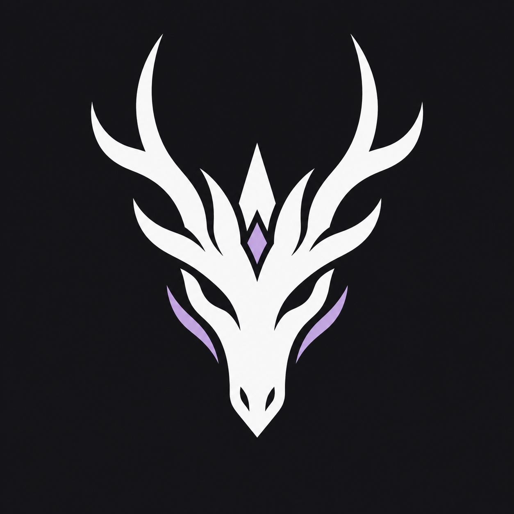

# Dravyn

A macOS-focused emulator for Apple Silicon, with a clean game library, controller configuration, and a Vulkan renderer powered by MoltenVK.

**Preview software.** Game compatibility varies. Missing character geometry, reflections, and other rendering issues remain under investigation. A successful build is not a guarantee that every game works.

- [Download the Mac preview](https://github.com/S1nPur1ty/Dravyn/releases)
- [Build and package for macOS](docs/build/Dravyn-macOS.md)
- [Report an issue](https://github.com/S1nPur1ty/Dravyn/issues)
- [Upstream project documentation](docs/UPSTREAM_README.md)

## Mac preview

The distributed ARM64 build requires an Apple Silicon Mac running macOS 26 or later, matching its bundled dependencies. Intel Macs are not supported by this download. The app is ad-hoc signed, not Apple-notarized.

Open the DMG, drag Dravyn to Applications, and launch it. If macOS blocks the app, review the warning and use System Settings → Privacy & Security → Open Anyway only if you trust the download. Do not disable Gatekeeper globally.

Game files, firmware, and console keys are not included. Supply your own required files through the app. The public build has its own stable `dravyn` settings/cache profile; experimental diagnostics are disabled by default.

## Credits and license

Dravyn is derived from [Eglantine](https://github.com/diamond3500/Eglantine), Eden, Yuzu, and Sudachi. Original copyright and license notices are retained. See [LICENSE.txt](LICENSE.txt), [LICENSES](LICENSES), and individual file headers for applicable terms. It is an independent project, not affiliated with Nintendo.

The macOS changes and interface were developed with AI assistance. Current build/package verification does not replace gameplay testing or human code review.
